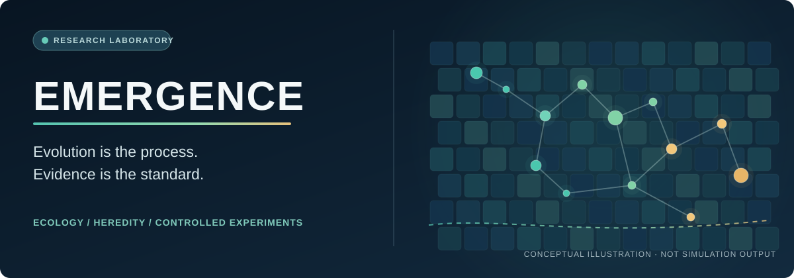

<div align="center">

# EMERGENCE

### What if intelligence were not designed, but discovered by evolution?

**A computational laboratory for evolution, adaptation, and the environmental conditions that make new capabilities useful.**

*Create the conditions · Let evolution explore · Follow the evidence*

[**Explore the laboratory ↓**](#explore-the-laboratory) · [**Run the CPU example →**](#try-a-reproducible-example) · [**Research boundaries →**](#what-the-results-do-not-say)

<br>


</div>



<sub>Conceptual illustration, **not simulation data**. See the [verified release scope](docs/release/VALIDATION.md) for actual execution evidence.</sub>

---

## The research question

**Under what conditions do useful adaptations arise, persist and spread?**

Emergence combines configurable ecological worlds, heritable agent models, controlled experiments, and recorded execution evidence. Instead of programming a desired intelligent behavior directly, the research asks which conditions make adaptive capabilities useful to evolving populations.

Intelligence, cooperation and cultural evolution remain **research ambitions**, not established results of this source distribution. A population surviving a disturbance is not, by itself, proof of intelligence or increased evolvability.

## Explore the laboratory

| Research surface | What the source contains | Explore |
|:--|:--|:--|
| **Worlds and ecology** | Resource landscapes, configurable environments and ecological dynamics | [WorldKit](emergence_worldkit/) · [World implementations](engine/env/) |
| **Agents and heredity** | Policies, genomes, mutation, selection and experimental adaptation mechanisms | [AgentKit](emergence_agentkit/) · [Evolution](engine/evolution/) |
| **Experiment design** | Matched treatments, deterministic campaign compilation and explicit execution requests | [Lab](emergence_lab/) · [Composition](eiel_composition/) |
| **Evidence and replay** | Typed identities, checkpoint contracts, artifact inventories and paired comparisons | [Contracts](emergence_contracts/) · [Evidence](emergence_evidence/) |


*Conceptual research workflow. The repository contains both modular interfaces and legacy integrated runtime components. Their boundaries are still evolving; this is not a stable general-purpose simulation API.*

## Try a reproducible example

The verified beginner path is **Linux x86-64, Python 3.14, and CPU-only PyTorch**. You need a C++ compiler and Ninja for the native example; no GPU, cloud account, API key or historical archive is required.

```bash
git clone https://github.com/jedufa/emergence.git
cd emergence
python3.14 -m venv .venv
. .venv/bin/activate
python -m pip install --index-url https://download.pytorch.org/whl/cpu torch==2.10.0
python -m pip install -r requirements-cpu.txt
python -m pip install ".[research,dev]"
python -I examples/release/component_smoke.py
```

**Important:** The component smoke verifies world configurations and packaged contract resources. **It does not simulate evolution.**

Continue with the [step-by-step CPU experiment walkthrough](QUICKSTART.md) to build the native owner, run a matched treatment pair, verify checkpoint continuations and inspect the evidence receipts.

### What that example demonstrates

The walkthrough varies reproduction-attempt probability from **0 to 0.15**, using the same declared seed block and other inputs. It exercises six legacy generations of 160 ticks per treatment, then checks exact midpoint continuation.

The recorded comparison is **one paired block**, not independently replicated scientific evidence. The [validation record](docs/release/VALIDATION.md) documents its tested environment, observations, local engineering checks and exclusions.

## Use the components

The source also exposes modular research interfaces:

```python
from dataclasses import replace
from emergence_worldkit import EnvConfig
from emergence_agentkit import MLPPolicy

world = replace(EnvConfig(), width=32, height=32, patch_world_enable=True)
policy = MLPPolicy(obs_size=4, hidden_size=12, n_actions=3)
```

This illustrates configuration and construction, not a complete experiment. The [CPU walkthrough](QUICKSTART.md) is the recommended end-to-end starting point.

## What the results do not say

Scientific validity depends on the **question, controls, seed independence, intervention, measurement and recorded implementation**. Exact replay is valuable only when source, checkpoint and artifact identities support it.

This public preview does **not** establish general intelligence, cultural evolution, broad evolvability, GPU parity, Full Evolution, or inherited formal Qualification. Advanced CUDA, cluster, historical operator and long-campaign workflows need separate compatible artifacts and validation. Some historical tests remain outside the supported CPU gate, with their limitations openly recorded.

[**Verification and exclusions**](docs/release/VALIDATION.md) · [**Public source scope**](docs/release/PUBLIC_SCOPE.md) · [**Quickstart**](QUICKSTART.md)

## Participate

Explore a world, reproduce the bounded CPU example, challenge an interpretation, or propose an experiment with explicit controls. Changes should preserve reproducible identities and distinguish observations from claims.

[**Contributing**](CONTRIBUTING.md) · [**Security**](SECURITY.md) · [**Third-party notices**](THIRD_PARTY_NOTICES.md)

Eligible first-party source, tests and documentation are offered under **[Apache-2.0](LICENSE)**, Copyright © 2026 Jean-Francois Dufour. Included upstream material retains its own license terms, including BSD, Sun fdlibm and LGPL-2.1-or-later. Third-party trademarks, datasets, CUDA tools and absent binaries are not licensed by this repository.

---

<div align="center">

### Build the world. Run the experiment. Respect the evidence.

*EMERGENCE · Evolutionary Intelligence Emergence Laboratory*

</div>
