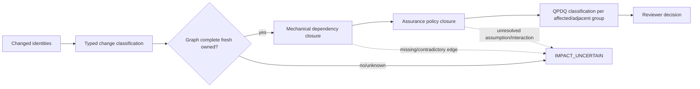

# Qualification-impact risk assessment

## Decision

Keep the proposed two-stage impact model, but run it in advisory shadow mode until EIEL has a complete, typed, owner-declared, fresh dependency graph. It may propose an impact map; it must not publish qualification authority.

## Existing authority boundary

- C-140 Evidence and C-150 Capability/Qualification already define a frozen seam.
- Evidence validates artifacts, bindings, schemas, comparisons, measurements, and mechanical rules.
- Assurance may assess bounded claims and recommend preservation/inheritance/delta.
- Mechanical decision payloads do not publish authority. The existing Qualification Manager, substantive semantic review/decision, and controlled authority-register publication remain distinct; QRR/Launchpad consume the published bounded authority and never grant it.
- Mechanical PASS never implies semantic or scientific acceptance.

The current `EvidenceEvaluationV1.decision` and `EvidenceEvaluatorV1.decide()` names are too easy to misread as qualification authority. A future compatible revision should rename or strictly scope them to `mechanical_outcome` / `evaluate`, without rewriting historical evidence.

## Why the current solver is not authoritative

The current qualification impact projection maps path substrings to broad impact families. Unknown paths become explicit review, `automatic_invalidation` is false, and review is required. Its schema does not prove:

- typed edge kinds;
- completeness of source-to-contract-to-build-to-artifact-to-route-to-evidence-to-review-to-authority lineage;
- edge ownership and provenance;
- graph freshness against the target source;
- interaction topology or qualified-group adjacency;
- affected authority-record identities.

This fail-closed behavior is correct. A model must never invent missing dependency truth.

## Safe closure law



Required edge types include `IMPLEMENTS`, `IMPORTS`, `BUILDS`, `MATERIALIZES`, `EXECUTES_VIA`, `PRODUCES`, `EVALUATED_BY`, `SUPPORTS_CLAIM`, `REVIEWED_BY`, `QUALIFIES`, `HOLDS`, and `SUPERSEDES`. Every edge needs owner, source, digest, creation evidence, freshness rule, and unknown handling.

## Major risks in the supplied design

1. **Envelope membership is too strong.** Being numerically inside a range makes a run an inheritance candidate only. Source/route/artifact identity, supporting assumptions, interaction topology, claim scope, and boundary sentinels must also match.
2. **Assurance can become a god-layer.** Do not create a new decision store or parallel qualification owner. Compose current qualification records and procedures.
3. **False-positive inheritance is safety critical.** Any missing/stale/unowned edge must yield `IMPACT_UNCERTAIN`, never optimistic inheritance.
4. **False-negative invalidation is expensive.** Preserve exact unaffected groups and immutable historical decisions; do not reset qualification because packages moved.
5. **Legacy/tick-native translation is not inheritance.** A legacy G/T envelope cannot be algebraically converted into absolute-tick qualification.
6. **CAS identity is not assurance.** Byte identity supports binding; it does not prove semantic equivalence or claim validity.
7. **Migration order is wrong.** Impact mapping must precede every migration gate. The automated solver can arrive later only as a shadow implementation.

## Historical adversarial corpus

Before an impact tool informs authority-facing decisions, replay at least:

- dormant contract adapter/refactor with unchanged default route;
- opt-in facade beside an unchanged qualified direct route;
- reporting-only change;
- native ABI or rebuilt artifact change;
- byte-different native rebuild with an exact-equivalence claim;
- legacy generation route versus absolute-tick route;
- per-cell parameter transport crossing a qualified envelope;
- crash before producer inventory and crash after a sealed checkpoint;
- identical blob referenced by two Runs with different holds;
- path rename with a stable contract ID;
- evidence-rule or reviewer-policy change without runtime change;
- Q6 integration escape followed by a repaired successor target.

Acceptance requires zero unsafe inheritance, explicit uncertainty for incomplete truth, no lifecycle release beyond current exact disposition authority, and stable reproduction of current historical decisions.

## Qualification migration receipt

Every implemented architecture gate must bind:

- original and successor claim/route/source/artifact identities;
- old and new contract IDs and layered digests;
- preserved assumptions and interaction boundaries;
- original evidence/review/decision references;
- explicit QPDQ classification for every affected and adjacent group;
- inheritance basis and remaining delta;
- mechanical closure receipt;
- semantic reviewer verdict;
- rollback target.

Historical authority records are immutable. Migration creates a mapping/successor receipt; it does not rewrite the past.

## Artifact lifecycle boundary

Use two identities:

```text
BlobV1
  digest, size, media_type

ArtifactOccurrenceV1
  artifact_id, blob_refs, run_id, attempt_id, producer, role,
  schema, tick/segment, plan/source/build binding,
  declared lifecycle profile, producer inventory identity

ArtifactHoldOrDispositionReceiptV1
  artifact_id, prior receipt digest, retention classification,
  hold transition or release predicate, authority/evidence bindings
```

Producer occurrences are immutable; holds and disposition evolve through append-only receipts. CAS may deduplicate `BlobV1`. Only the existing manifest-bound lifecycle may classify and release occurrences, and a blob can be released only when every exact occurrence reference is lifecycle-authorized. Rejected evidence, diagnostic holds, replay obligations, interrupted recovery, incomplete inventories, and RX material remain roots/holds even when no accepted result points at them.

## Audit qualification statement

Existing qualification is unchanged by this read-only design audit. None is newly inherited or invalidated. Future Run/Attempt identity, shared admission, checkpoint binding, impact shadowing, RNG/backend, CAS, or authority-record migrations each require their own impact map and the narrowest faithful delta; broad requalification is not justified merely by architecture documentation.
